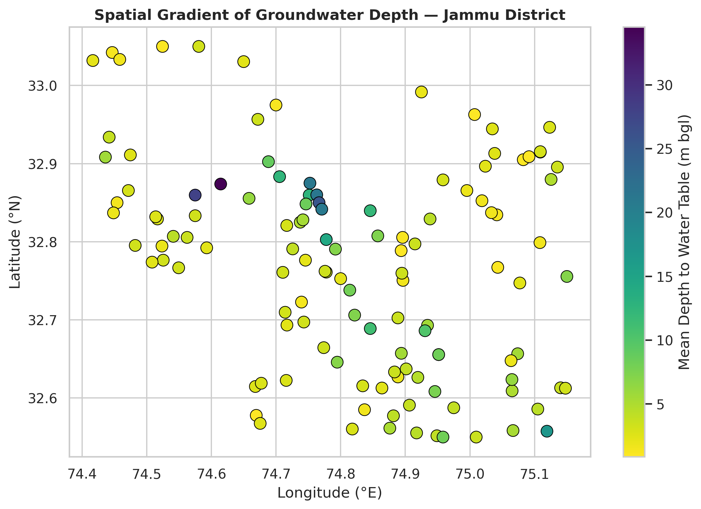

# Spatio-Temporal Groundwater Level & Monsoon Recharge Analysis — Jammu District (J&K)

An exploratory hydrogeological analysis of groundwater depth, seasonal fluctuation, and aquifer recharge across **Jammu District, Jammu & Kashmir**, built in Python using open monitoring records from the **Central Ground Water Board (CGWB)** via the National Water Data Portal (NWDP).

## Key Findings (2021–2023)

| Metric | Value |
|---|---|
| **Monitoring Stations Analysed** | 122 stations |
| **Cleaned Quarterly Observations** | 777 readings |
| **Temporal Coverage** | 2021 – 2023 |
| **Median Depth to Water Table** | 3.30 m bgl |
| **Observed Depth Range** | 0.06 m bgl (shallowest) to 38.46 m bgl (deepest) |
| **Median Monsoon Water-Table Rise (May to Nov)** | +1.46 m |

### Hydrogeological Interpretation
* **Kandi–Sirowal–Alluvial Transition:** The nearly 38-metre depth spread across a single district reflects the physical transition from the coarse, boulder-pebble piedmont zone (**Kandi belt**, northern Jammu) with deep water tables to the fine-grained **Sirowal and southern alluvial plains**, where groundwater sits within a few metres of the surface.
* **Monsoon Recharge Dominance:** Paired pre-monsoon (May) and post-monsoon (November) measurements confirm a median water-table recovery of **+1.46 m**, highlighting the aquifer network's strong dependence on southwest monsoon precipitation.

---

## Visual Outputs

### 1. Seasonal Water-Table Depth & Monsoon Recharge


### 2. Spatial Gradient of Groundwater Depth



### 3. Interactive Station Map

Explore station-wise mean depth to water table interactively:

[🌍 Open Interactive Jammu Groundwater Map](https://owais-geo.github.io/jammu-groundwater-analysis/jammu_groundwater_map.html)

## Methodology & Data QA Pipeline

1. **Automated Schema Standardisation:** Dynamic column matching and date parsing (`dayfirst=True`) to handle irregular government portal headers.
2. **Quality Control & Deduplication:** Removed missing timestamps and implausible depth records, and collapsed same-day repeat station measurements by taking daily means per `(station, date)`.
3. **Seasonal Classification:** Grouped CGWB quarterly rounds into Winter (Jan), Pre-Monsoon (May), Monsoon (Aug), and Post-Monsoon (Nov).
4. 4. **Seasonal Fluctuation Analysis:** Computed paired station-year pre-monsoon (May) minus post-monsoon (November) water-level change as:
   $$\Delta h = \text{Depth}_{\text{Pre-Monsoon}} - \text{Depth}_{\text{Post-Monsoon}}$$
   Positive $\Delta h$ represents a **measured seasonal water-table rise**, used here as a hydraulic indicator of monsoon recharge rather than a direct estimate of volumetric recharge (which would require aquifer-specific yield, $S_y$, under the Water-Table Fluctuation method: $R = S_y \cdot \Delta h$).

## Data Source
* **Central Ground Water Board (CGWB)**, Ministry of Jal Shakti, Government of India — *Manual Quarterly Groundwater Level Dataset (Jammu & Kashmir, 2021–2025)*, National Water Data Portal (NWDP).
* **Direct CSV Resource:** [CGWB J&K Quarterly Groundwater Level (2021–2025)](https://nwdp.nwic.gov.in/dataset/956add67-cba9-41a5-9d5c-96d73db44aef/resource/c9ddb1e5-02d6-4ef4-87e3-56efeff36211/download/gwl_manual_quarterly_cgwb_jk_2021_2025.csv)
* **Date Accessed:** November 2026
---

## Repository Structure

```text
jammu-groundwater-analysis/
│
├── data/
│   ├── jammu_gwl_clean.csv
│   └── jammu_gwq_clean.csv
│
├── figures/
│   ├── fig1_seasonal_water_level_jammu.png
│   └── fig3_spatial_depth_jammu.png
│
├── jammu_groundwater_map.html
│
└── README.md
